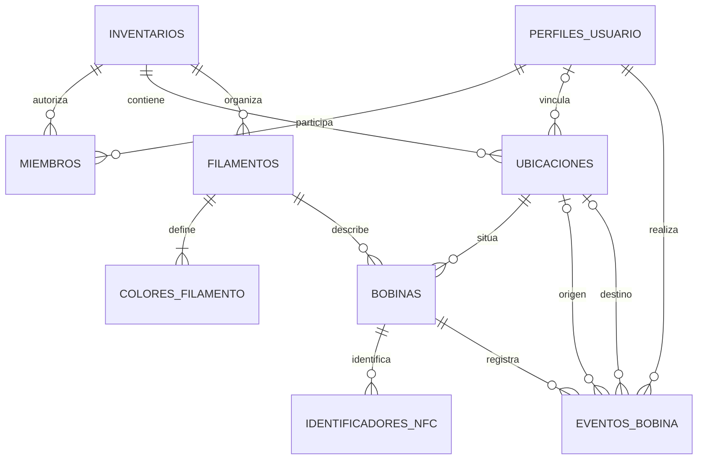

# Spoolio — Requisitos y decisiones

Estado: demostración local Android con NFC confirmado en Pixel en una versión anterior; entrega 0.2.1 preparada para nueva validación física. Integración Supabase implementada; esquema y cuentas confirmados por el usuario, salud remota comprobada y operaciones autenticadas pendientes de validación.

Última actualización: 19 de noviembre de 2026.

Este documento recoge las decisiones del usuario y los requisitos del documento inicial que siguen vigentes. Las aclaraciones posteriores prevalecen sobre el texto inicial. Se actualizará conforme se acuerden nuevos requisitos; las cuestiones pendientes no son decisiones cerradas.

## 1. Objetivo y alcance

- **OBJ-01.** La aplicación se llama **Spoolio**.
- **OBJ-02.** Gestiona un inventario compartido de unidades de filamento para un pequeño grupo dedicado a impresión 3D.
- **OBJ-03.** La prioridad actual es una **app Android**, en español, distribuida como APK de uso personal. No se publicará inicialmente en una tienda.
- **OBJ-04.** Habrá una base de datos alojada provisionalmente en **Supabase**, con PostgreSQL y Supabase Auth. Preparar la arquitectura para una futura migración a un Intel NUC con Docker, sin implementar ese despliegue ahora.
- **OBJ-05.** La primera versión tendrá una interfaz sencilla y funcional. El diseño visual y UX se perfeccionarán con el usuario.
- **OBJ-06.** El documento original incluía una web adaptable; posteriormente el usuario acotó el trabajo actual a la app. Una web independiente no es un entregable de esta fase. Una vista de desarrollo en navegador puede servir para validar la interfaz, pero no sustituye las pruebas Android/NFC.

## 2. Personas, cuentas y ubicaciones

- **ACC-01.** Usuarios iniciales: el usuario promotor, Juan y Óscar. El promotor usa el nombre visible Guillermo.
- **ACC-07.** Configuración permite cambiar contraseña indicando la actual y dos veces la nueva. Validar coincidencia, mínimo 8 caracteres y contraseña distinta; el servidor verifica la actual. Aviso flotante de éxito y campos vacíos al guardar. Solo cuentas reales.
- **ACC-02.** Inicio de sesión individual mediante correo y contraseña.
- **ACC-06.** Conservar la sesión en el dispositivo y renovar sus credenciales automáticamente; cerrar sesión desde Configuración. No guardar la contraseña. El usuario confirmó las cuentas reales de Juan y Óscar el 19/11/2026; example.com solo se conserva como marcador en ejemplos/pruebas.
- **ACC-03.** Todos los miembros autorizados pueden crear, modificar y retirar bobinas, y gestionar perfiles del catálogo.
- **ACC-04.** Registrarse no concede automáticamente acceso al inventario compartido. Mantener autorización de miembros y políticas RLS, sin añadir complejidad innecesaria al uso privado.
- **ACC-05.** Nunca incluir claves privilegiadas de Supabase en la app. Un UID NFC identifica una bobina, no autentica a una persona.
- **UBI-01.** Las bobinas **no tienen propietario ni responsable** en el modelo de la aplicación: tienen una **ubicación actual**.
- **UBI-02.** Ubicaciones iniciales: con el usuario promotor, con Juan, con Óscar y en Fablab.
- **UBI-03.** Fablab es una ubicación compartida, no una cuenta que deba iniciar sesión.
- **UBI-04.** Las ubicaciones correspondientes a personas se vinculan a sus cuentas para poder mostrar «Mis bobinas» y ofrecerlas en el selector de ubicación.
- **UBI-05.** El usuario que registra un movimiento es un dato distinto de la ubicación de origen o destino.

## 3. Navegación

| ID | Sección | Comportamiento acordado |
| --- | --- | --- |
| NAV-01 | Mis bobinas | Solo unidades activas que están con el usuario conectado. No implica propiedad. |
| NAV-02 | Inventario | Todas las unidades activas, mostrando dónde están. Permite consultar las de otras personas y Fablab mediante filtros. |
| NAV-03 | Escanear | Leer NFC y abrir las acciones correspondientes a una etiqueta conocida o desconocida. |
| NAV-04 | Catálogo | Consultar, añadir y modificar perfiles de filamento, tengan o no unidades en inventario. Mostrar si la muestra está hecha. |
| NAV-05 | Configuración | Datos de la cuenta y ajustes. El detalle de preferencias se concretará después. |

- **NAV-06.** El botón octogonal inicia directamente la lectura NFC y muestra la animación decorativa Benchy y el estado de lectura por separado. Durante una lectura activa no muestra botones. Si falla (NFC apagado, error o tiempo agotado), muestra «Volver a intentar»; al reintentar se oculta mientras lee. Salir cancela la lectura automáticamente. En navegador se indica la indisponibilidad de NFC; el Benchy sigue animándose como decoración. Escanear no ofrece alta manual: esta se inicia mediante un botón de bobina neutra con + a la derecha del título de Mis bobinas e Inventario, igual que el alta de filamentos del catálogo. Se mantiene el alta desde un perfil de catálogo y desde una etiqueta desconocida.
- **NAV-07.** Buscar y filtrar inventario por marca, material, color y ubicación. Las unidades retiradas quedan fuera de las vistas activas.
- **NAV-08.** Navegación fija inferior en este orden: Mis bobinas, Inventario, Escanear, Catálogo, Configuración. Escanear es el botón central más grande, con forma de octógono de esquinas redondeadas e icono NFC minimalista sin texto visible. Los cuatro botones laterales son cuadrados; los adyacentes se ajustan al contorno del octógono.
- **NAV-09.** La barra inferior ocupa todo el ancho de la pantalla, sin marco ni contenedor exterior redondeado y sin márgenes laterales. Mantener el área segura inferior del dispositivo.
- **UI-01.** Modo oscuro predeterminado. Configuración incluye un botón a la derecha del título, en la misma posición y tamaño que las altas de bobinas y filamentos. Sin texto visible: SVG minimalista de sol en modo oscuro (cambia a claro) y luna en modo claro (cambia a oscuro), con nombre accesible. Sustituye al panel Apariencia y conserva la preferencia en el dispositivo.

- **UI-02.** Base visual neutra (negros, grises y blancos). Acentos por sección: Mis bobinas azul, Inventario verde, Catálogo naranja y Configuración rojo. Los colores reales de los filamentos se conservan. El botón Escanear es claro en modo oscuro y oscuro en modo claro, independiente del acento de sección.

- **UI-03.** Interfaz minimalista: eliminar lemas y subtítulos decorativos. Geometría más cuadrada, con radios pequeños en tarjetas, campos y botones. Mantener los círculos que representan filamento y el octógono de escaneo. Usar la paleta de referencia del usuario para azul, verde, naranja y rojo, con variantes legibles por tema. Catálogo usa el naranja de la referencia (#FF9800 como base), sustituyendo el amarillo anterior.

- **UI-04.** Cambiar perfil solo en Configuración. Solo en Inventario y Mis bobinas, el orden es título, contadores y buscador; los contadores se sitúan debajo del título y reducen su altura aproximadamente un 10 %. Son exactamente dos columnas: primero las unidades activas con el usuario conectado y después el total de unidades activas del inventario, independientemente de la sección o filtros.

- **UI-05.** Catálogo no muestra los contadores. El botón octogonal combina bobina SVG neutra y símbolo NFC con fondo transparente, superpuesto en su esquina inferior izquierda, y centraliza escaneo y alta manual. La pantalla de escaneo usa el lector nativo en Android e indica su indisponibilidad en navegador; nunca simular una lectura en la app.

- **UI-16.** Los avisos de éxito (incluido guardar bobinas y filamentos) se muestran como notificación flotante, sin desplazar la interfaz, con cierre automático a los 5 segundos y botón × a la derecha. Cada nuevo aviso reinicia el tiempo, aunque repita el texto. Mantener errores visibles y la excepción de ubicación sin aviso (HIS-05).

- **UI-15.** Variante actual: Escanear muestra un Benchy en perspectiva de tres cuartos, con volúmenes blancos y grises y sin contorno, inspirado en la referencia visual aportada (estilo Sin contorno), en SVG ligero, con balanceo y ondas en bucle. Sustituye al símbolo de lectura y a la estantería para reducir elementos dibujados. La flotación combina elevación y balanceo leves con ciclos diferentes; con NFC apagado o no disponible en Android, el barco aparece inclinado y quieto sobre un banco de arena. Consulta del estado al entrar y al volver a la app. Control temporal eliminado de la entrega 0.2.0; el estado depende únicamente del NFC real; respetar movimiento reducido. La versión con estantería queda guardada en Git (315176e).

- **CFG-01.** Configuración muestra estado real NFC (activado, desactivado, no compatible o error de consulta) y versión. En web indica que NFC no está disponible y muestra la versión del paquete como desarrollo; Android obtiene versión y compilación de la app instalada. Actualizar el estado al volver a la app y mediante botón; no iniciar lecturas al consultar.

- **UI-14.** Las tarjetas del catálogo muestran siempre la variante debajo del nombre (Basic, Matte, Silk, etc.) y añaden Translúcido cuando corresponde. Si no se ha definido variante ni translucidez, muestran «Sin variante»; no inferir una familia del material.

- **UI-13.** El formulario del catálogo ofrece botones con hélice para Sólido y Gradiente (excluyentes) y un botón independiente Translúcido (activable/desactivable con cualquiera). La selección queda resaltada y los SVG muestran cada efecto. Al guardar sólido se conserva solo el primer color; al alternar antes de guardar se mantienen los colores en el formulario. Los perfiles antiguos multicolor se presentan como gradiente y conservan su valor si no se cambia la distribución explícitamente.

- **UI-12.** Las acciones de cada tarjeta del catálogo muestran hélice neutra con lápiz para editar y bobina neutra con + para añadir unidad, sin texto visible y con nombres accesibles. Las tarjetas del catálogo mantienen la misma altura, con hélice arriba y botones alineados abajo; Muestra y su indicador quedan también anclados abajo, justo encima de la línea divisoria. El espacio sobrante queda entre el texto del perfil y este bloque inferior.

- **UI-11.** En la ficha y en el formulario de alta de bobina, añadir etiqueta NFC se representa con un circuito NFC circular SVG minimalista con dos trazos de antena, chip pequeño sin conexiones y símbolo +, con fondo transparente y nombre accesible «Añadir etiqueta NFC» en la ficha; en el alta indica leer primera, segunda u otra etiqueta según las ya registradas.

- **UI-10.** Los símbolos de los botones tienen fondo transparente, incluidos los superpuestos de lápiz, papelera y añadir. Conservar los SVG y el fondo propio del botón.

- **UI-09.** El editor de bobinas permite buscar y seleccionar perfiles por ambos idiomas, marca y material; cambiar el perfil registra la edición. El selector es una lista siempre visible con la hélice del catálogo, nombre, marca y material, con altura para tres filas y desplazamiento vertical; el buscador filtra la lista y seleccionar no la cierra. La vista previa no muestra texto opaco/translúcido. La ubicación se omite al editar y se cambia desde la ficha; se conserva en el alta. Formato mediante botón SVG neutro que muestra el formato contrario al actual (el destino al pulsarlo) y alterna carrete/refill; la vista previa conserva el formato actual. Cantidad mediante deslizador de cuatro posiciones con puntos y los niveles aproximados acordados. El deslizador y su punto activo usan la misma escala del inventario: 100 verde, 75 verde amarillento, 50 ámbar y 25 rojo.
- **TEC-09.** Agrupar cambios en PC/web y generar una APK solo cuando el usuario lo solicite explícitamente.

- **UI-08.** En la ficha, editar se representa con bobina neutra y lápiz; retirar con carrete vacío y papelera, sin textos visibles pero con etiquetas accesibles. Retirar conserva la confirmación. El botón de ubicación usa bobina y nombre actual, y permite elegir otra ubicación.

- **UI-07.** El botón de añadir filamento de la cabecera del catálogo muestra la hélice neutra con un símbolo + superpuesto, sin texto visible, conservando el nombre accesible «Añadir filamento». Se sitúa en la misma fila del título, alineado al margen derecho también en móvil.

- **UI-06.** El título de cada pestaña usa su color de acento. Los números y textos de los contadores usan azul para «Contigo» y verde para «Total en inventario», independientemente de la pestaña. Mantener contraste legible en ambos temas.

- **ORD-01.** Inventario y Mis bobinas incluyen un desplegable directo «Ordenar» (sin panel intermedio): nombre A–Z/Z–A, marca, material, ubicación, menor cantidad y más recientes. La opción Ubicación solo se ofrece en Inventario; en Mis bobinas se usa Nombre si estaba seleccionada Ubicación. Guardar la preferencia local. Mantener siempre contiguas las unidades del mismo perfil del catálogo (también montadas/refill). Ordenar grupos completos: menor cantidad por su unidad menos llena, recientes por su alta más reciente y ubicación por su primera ubicación alfabética; luego ordenar unidades dentro del grupo. Los filtros se aplican antes de agrupar.

## 4. Catálogo de filamentos

- **IDI-01.** Cada perfil tiene un nombre español (`name`) y un nombre inglés (`nameEn`). Español es el idioma de visualización predeterminado; Configuración permite elegir inglés. La preferencia se guarda por dispositivo en esta demo. La interfaz sigue en español.
- **IDI-02.** Buscar siempre en ambos nombres, además de marca, material y colores, sin depender del idioma visible y sin distinguir mayúsculas o acentos. No traducir automáticamente nombres personalizados. Si falta traducción, mostrar el nombre disponible.
- **IDI-03.** Conservar los nombres existentes al migrar. Solo los ejemplos conocidos y no renombrados reciben traducciones preparadas. Los formularios permiten mantener ambas versiones explícitamente.
- **VIS-10.** Distribución de color y translucidez son propiedades independientes y explícitas de cada perfil, no se deducen del texto del nombre, del idioma ni del material. Una futura familia podrá proponer valores predeterminados, pero el perfil conservará la configuración final. Esta etapa no añade tablas de familias ni lógica de inferencia.

### Representación visual aprobada

- **VIS-01.** Usar el SVG entregado por el usuario, conservado en `docs/referencias/bobina-minimalista-v2.svg`, y las variantes de `docs/referencias/ejemplos-bobinas-translucidas.png`. Mantener geometría, fondo transparente y laterales opacos blanco roto cálido. Los temas usan variaciones suaves de la misma tonalidad, algo más oscura en modo claro, con contornos contrastados; no cambia el color del filamento.
- **VIS-02.** Inventario y Mis bobinas ofrecen cuadrícula de **tres columnas** o lista con icono a la izquierda. Guardar la preferencia local. Las tarjetas muestran marca, material/variante y nombre. En Inventario también muestran ubicación; en Mis bobinas se omite por redundante. Ambas vistas muestran cantidad aproximada mediante barra horizontal inferior en cuadrícula y vertical en lista, verde para el nivel ≤100 %, pasando por verde amarillento y ámbar hasta rojo para <25 %. La barra no muestra texto: solo relleno de color y tramo restante gris adaptado al tema. El nivel aproximado se conserva en accesibilidad y en la ficha; no implica medición exacta. El resto se consulta al abrir la ficha.
- **VIS-03.** El campo existente `mounted` (montada en carrete) controla ambos laterales. No duplicar este estado.
- **VIS-04.** Añadir `translucent: boolean` a los perfiles, con valor predeterminado `false`. Los datos locales antiguos sin este campo se interpretan como opacos. No hay migración SQL en esta etapa sin backend; el futuro esquema debe incluir un booleano no nulo con default false.
- **VIS-05.** Los colores existentes se reutilizan en su orden: un color uniforme o degradado con paradas equidistantes. En multicolor, la cara circular y la superficie exterior tienen degradados independientes: ambos recorren todos los colores; el exterior sigue la curvatura elíptica de las vueltas y se ajusta al ancho visible con o sin carrete, en lugar de mostrar bandas rectas. Las superficies comparten borde y no se superponen. La distinción del perfil entre gradiente y multicolor simultáneo se conserva, aunque este icono representa ambos mediante degradado según el diseño aprobado.
- **VIS-06.** En translúcidos se dibuja el damero del SVG bajo rellenos de color sin solapamiento con opacidad 0,65. Es una constante visual, no editable. El recorte excluye exterior y agujero; nunca reducir la opacidad global ni la de los laterales.
- **VIS-07.** Componente React SVG inline compartido entre inventario, detalle y formularios, con IDs únicos por instancia, respaldo neutro para colores inválidos, previsualización inmediata y nombres accesibles cuando el icono no sea decorativo.
- **VIS-08.** «Filamento translúcido» se edita en el catálogo. Mostrar indicación textual en ficha, catálogo y formularios; en las tarjetas compactas se incluye en la descripción accesible sin ampliar los tres datos visibles solicitados.
- **VIS-11.** Las tarjetas del catálogo usan la muestra helicoidal aportada en `docs/referencias/helice-limpia.svg`, coloreada con los colores ordenados del perfil y damero para translúcidos. Inventario y Mis bobinas mantienen el SVG de bobina. La hélice representa el perfil, independientemente de si la muestra está hecha. La etiqueta de material del catálogo tiene aproximadamente la mitad de la altura del SVG (38 px frente a 76 px), con texto centrado y más legible.

- **VIS-09.** Añadir ejemplos locales temporales de las ocho combinaciones y colores blanco/negro, inspirados en familias Bambu Lab. Identificarlos internamente y permitir limpiarlos desde Configuración sin borrar unidades creadas por el usuario. Las combinaciones ficticias deben indicarse como tales.

- **CAT-01.** Un perfil del catálogo describe un tipo de filamento, no una unidad física.
- **CAT-02.** Campos: marca, material, variante cuando proceda, nombre comercial del color, tipo de distribución de color y lista ordenada de colores.
- **CAT-03.** Un perfil puede tener **cero, una o varias unidades** asociadas.
- **CAT-04.** Toda unidad del inventario debe estar asociada a **exactamente un perfil** del catálogo. No se admiten unidades sin perfil.
- **CAT-05.** Al registrar una unidad se selecciona un perfil existente o se crea uno nuevo. Los perfiles se reutilizan en compras posteriores.
- **CAT-06.** Se pueden crear perfiles de cualquier marca, por ejemplo Winle.
- **CAT-07.** Cada perfil tiene un indicador compartido **«Muestra hecha / No hecha»**. No se necesita registrar quién tiene la muestra ni dónde está. En las tarjetas se muestra solo un indicador no interactivo: palabra «Muestra» seguida de círculo con marca verde si está hecha, círculo con guion neutro si está pendiente. Se modifica desde el formulario de edición de filamento.
- **CAT-08.** Agotar o retirar una unidad no elimina su perfil ni cambia el indicador de muestra.
- **CAT-09.** No eliminar perfiles con unidades asociadas, incluidas las retiradas, para preservar la integridad del historial.
- **CAT-10.** El 19/11/2026 se autorizó importar las familias solicitadas de Bambu Lab y Winkle PLA HD Texture, a partir de 3dfilamentprofiles.com o fuentes oficiales autorizadas como alternativa. No inventar HEX ni otros datos; listar perfiles incompletos aparte. El usuario confirmó que los datos existentes entonces eran de prueba y autorizó su reemplazo, preservando cuentas y ubicaciones. Se entregó el SQL y el usuario confirmó la carga. No repetir ese reemplazo ni extender la autorización de borrado a datos posteriores; futuras ampliaciones incrementales. Fuentes y pendientes en supabase/catalog/README.md.

### Colores

- **COL-01.** Cada perfil tiene **uno o varios colores**, sin un límite fijo de negocio.
- **COL-02.** Cada color guarda código hexadecimal `#RRGGBB`, orden y nombre opcional heredado. El editor no solicita nombres de componentes: solo códigos hexadecimales. Sólido permite un código; gradiente permite añadir varios. Subir y eliminar colores se representan mediante iconos SVG transparentes. La flecha de subir solo aparece en gradiente.
- **COL-03.** El nombre comercial del color del perfil es independiente del nombre opcional de cada componente.
- **COL-04.** Tipos de distribución: **unicolor**, **gradiente** y **multicolor simultáneo**.
- **COL-05.** Guardar el orden para representar en el futuro un color sólido, un degradado o segmentos. La representación es orientativa, no una predicción exacta del resultado impreso.
- **COL-06.** Los colores se modelan como registros asociados al perfil; no guardar solo un hexadecimal en el perfil.

## 5. Unidades del inventario

- **BOB-01.** Cada «bobina» representa una unidad o carga de filamento con ID interno propio, independiente de sus etiquetas NFC.
- **BOB-02.** Datos necesarios: perfil de catálogo, ubicación actual, si está montada en un carrete o es un refill sin montar y cantidad aproximada restante.
- **BOB-03.** No se necesita registrar peso.
- **BOB-04.** El usuario propuso los niveles `≤100 %`, `<75 %`, `<50 %` y `<25 %`. La presentación y los límites exactos están pendientes de cerrar; no sustituirlos silenciosamente por porcentajes exactos.
- **BOB-05.** Una carga nueva es una unidad nueva, incluso si reutiliza el mismo carrete. No sobrescribir el historial de la anterior.
- **BOB-06.** Cuando se agota una unidad, se elimina de las vistas activas mediante **borrado lógico**. «Agotada» no es un estado visible del inventario activo.
- **BOB-07.** Conservar fecha de retirada, usuario que la realizó y motivo, además de los datos y movimientos anteriores.
- **BOB-08.** Distinguir el agotamiento de otras retiradas manuales. Los controles concretos de la interfaz están pendientes.

## 6. Identificación NFC

- **NFC-01.** Leer únicamente el UID de las etiquetas originales Bambu Lab. No descifrar su memoria ni escribir en ellas.
- **NFC-02.** Usar acceso NFC nativo de Android, no Web NFC para estas etiquetas.
- **NFC-03.** El usuario comprobó con NXP TagInfo en un Pixel 9 Pro XL que una misma unidad tiene dos etiquetas MIFARE Classic con UID distintos: `9E:47:5A:93` y `CE:3B:61:93` son un ejemplo aportado, no datos de demostración que deban insertarse automáticamente.
- **NFC-04.** Una unidad puede tener cero, uno, dos o más identificadores. Cada UID normalizado solo puede estar asociado a una unidad del inventario compartido.
- **NFC-05.** Normalizar UID de forma consistente, por ejemplo mayúsculas sin separadores: `9E475A93`. No asumir que todos tienen la misma longitud.
- **NFC-06.** El alta debe guiar el escaneo de ambas etiquetas. Permitir completarla si una o ambas están estropeadas o no disponibles, y añadir etiquetas después.
- **NFC-07.** El detalle de cómo distinguir «estropeada», «ausente» y «pendiente» aún está por decidir.
- **NFC-08.** Etiqueta conocida de unidad activa: abrir su ficha y permitir consultar, editar o cambiar ubicación. Escanear por sí solo no cambia nada.
- **NFC-09.** Etiqueta desconocida: ofrecer crear una unidad o asociarla a una existente. Evitar crear otra unidad solo por escanear la segunda etiqueta.
- **NFC-10.** Impedir asociar una etiqueta ya vinculada a otra unidad y mostrar un mensaje comprensible.
- **NFC-11.** Conservar las etiquetas de unidades retiradas; al escanearlas, informar de que esa unidad fue retirada, sin tratarla como desconocida.
- **NFC-12.** Prever futuras etiquetas propias, posiblemente NTAG213, y la separación entre carrete reutilizable y carga. El sistema de vinculación y reutilización de esas etiquetas se diseñará cuando se incorpore esa función.
- **NFC-13.** Cualquier simulación de escaneo debe estar claramente identificada como simulación y nunca presentarse como lectura real.

## 7. Movimientos, historial y consistencia

- **HIS-01.** Mostrar la ubicación actual en ficha e inventario. Guardar aparte los cambios históricos.
- **HIS-02.** Cada transferencia registra unidad, ubicación de origen, ubicación de destino, fecha del servidor y usuario que realizó la acción.
- **HIS-03.** Actualizar ubicación y crear el evento en una única transacción.
- **HIS-04.** Gestionar modificaciones simultáneas para evitar cambios perdidos e historiales incoherentes.
- **HIS-05.** El botón de ubicación muestra una bobina con el nombre de la ubicación actual y, con pulsación corta, abre un desplegable de botones para todas las personas y Fablab, sin buscador ni confirmación adicional. Elegir un botón guarda automáticamente, sin aviso de guardado correcto; los errores sí se muestran. Mantener pulsado 600 ms mueve directamente a la ubicación del usuario conectado, sin abrir el desplegable al soltar. Desplazar el dedo o cancelar el gesto anula la pulsación larga. Se registra el traslado; seleccionar la ubicación actual no genera movimiento. Sustituye al botón «La tengo yo».
- **HIS-06.** Permitir cambios manuales de ubicación desde la ficha.
- **HIS-07.** Registrar alta y retirada. La retirada y su evento se guardan de manera atómica.
- **HIS-08.** Conservar el historial después de retirar la unidad. La pantalla de consulta de historial y las estadísticas pueden incorporarse más adelante.
- **HIS-09.** No mostrar una operación como guardada si falla la conexión. No se necesitan escrituras sin conexión en esta versión.

## 8. Modelo de datos de referencia

Esquema implementado en supabase/migrations/202611190001_spoolio.sql; aplicado al proyecto según confirmación del usuario; comprobación remota de salud correcta. Los nombres pueden adaptarse a convenciones técnicas sin cambiar su significado.

| Entidad | Función |
| --- | --- |
| Inventarios | Grupo de datos compartido. Se usará un inventario inicialmente. |
| Perfiles de usuario | Datos visibles vinculados a Supabase Auth; no guarda contraseñas. |
| Miembros | Acceso autorizado de cada usuario al inventario. |
| Ubicaciones | Personas o lugares donde puede estar una unidad; las personales se vinculan a cuentas. |
| Filamentos | Perfiles del catálogo y estado de muestra hecha. |
| Colores de filamento | Uno o más componentes con hexadecimal y orden por perfil. |
| Bobinas | Unidades físicas con perfil obligatorio, ubicación, formato, cantidad y datos de retirada. |
| Identificadores NFC | UID normalizados vinculados a unidades. |
| Eventos de bobina | Alta, transferencias y retirada, con actor y fecha del servidor. Se puede ampliar a auditoría de ediciones. |

Las relaciones entre entidades deben pertenecer al mismo inventario. Aplicar esta regla en la base de datos, no solo en la interfaz.

## 9. Tecnología, entregables y validación

- **TEC-01.** React, TypeScript y Vite con Capacitor 8 para Android. Complemento local SpoolioNfc limitado a UID mediante Reader Mode de Android, sin leer memoria ni escribir.
- **TEC-02.** Mantener migraciones SQL versionadas, políticas RLS y funciones transaccionales necesarias.
- **TEC-03.** Proporcionar variables de entorno de ejemplo sin secretos e instrucciones de configuración, ejecución y compilación Android.
- **TEC-04.** Separar datos ficticios de demostración de datos reales.
- **TEC-05.** Incluir pruebas significativas de permisos, asociación de etiquetas y transferencias.
- **TEC-06.** Documentar la exportación de datos para facilitar copias y futura migración.
- **TEC-07.** El Pixel está disponible, pero no puede conectarse por USB al ordenador actual. Las pruebas físicas podrán realizarse desde el ordenador de casa. No se ha confirmado la instalación de Android Studio ni la posibilidad de instalar herramientas aquí.
- **TEC-08.** Proyecto Supabase comunicado el 19/11/2026; URL/clave pública configuradas localmente y esquema inicial confirmado por el usuario; pendiente validación de operaciones autenticadas.

## 10. Recorrido de implementación propuesto

1. Crear documentación, carpeta de proyecto y workspace de VS Code.
2. Preparar modelo de datos, acceso y catálogo.
3. Completar el recorrido manual: iniciar sesión → crear perfil → añadir unidad → verla desde otra cuenta → cambiar ubicación → retirarla manteniendo historial.
4. Incorporar el recorrido NFC: escanear → registrar o asociar ambas etiquetas → consultar → mover explícitamente.
5. Validar entre cuentas y en el Pixel; ajustar UX con el usuario.

El recorrido local está implementado. El 19/11/2026 el usuario autoriza conectar Supabase gratuito, con monitor externo de solo lectura.

### Etapa local autorizada

- **DEMO-01.** Construir el recorrido manual antes de conectar una base de datos externa. Supabase no requiere el NUC. Aplazamiento inicial sustituido por autorización del 19/11/2026 para el plan gratuito alojado.
- **DEMO-02.** Usar almacenamiento local separado, identificado como demostración, para probar el flujo. No es sincronización compartida ni soporte offline de producción.
- **DEMO-03.** Sustituir provisionalmente el inicio de sesión real por selección explícita de perfil demo. No solicitar ni almacenar contraseñas ficticias. Correo y contraseña siguen siendo el requisito para la versión conectada.
- **DEMO-04.** La implementación local usa provisionalmente los cuatro niveles propuestos por el usuario. Su redacción definitiva sigue pendiente.
- **DEMO-05.** La demo registra fechas del dispositivo. La versión conectada debe usar fechas del servidor y validación transaccional de permisos.
- **DEMO-06.** Se incluye consulta básica de unidades retiradas para verificar que el historial se conserva; no se implementan estadísticas.

## 11. Futuro y fuera de alcance actual

- Dispositivo ESP32 para registrar bobinas.
- Migración y despliegue en NUC con Docker.
- Lista de compra compartida vinculada al catálogo.
- Representación visual más elaborada de colores y muestras.
- Carretes reutilizables identificados con etiquetas propias.
- Estadísticas y pantalla específica de historial.
- Integración con impresoras, consumo automático, reservas y tienda.

## 12. Cuestiones pendientes

- Confirmar los niveles y presentación de cantidad aproximada.
- Decidir cómo registrar incidencias o ausencia de etiquetas.
- Confirmar si se necesita un campo de notas por unidad; no se ha acordado después de simplificar la ficha.
- Definir el alta inicial y gestión de miembros autorizados.
- Validar operaciones autenticadas en Supabase; preparar herramientas Android y firma en el equipo de casa.
- Elegir dependencias tras verificar su compatibilidad.
- Completar los 17 perfiles pendientes del catálogo (el SQL inicial ya está cargado según el usuario); mantenimiento posterior mediante cargas incrementales.
- Diseñar pantallas, acciones de retirada y posible restauración de unidades; restaurar no es todavía un requisito confirmado.

## 13. Registro de cambios

| Fecha | Cambio |
| --- | --- |
| 2026-11-19 | Catálogo oficial preparado (270 perfiles / 292 colores, 17 pendientes), reemplazo de datos de prueba autorizado; carga remota confirmada por el usuario. Cambio de contraseña y tema SVG en Configuración. Guardar/subir Git para continuar en casa; nueva APK solo bajo petición posterior. |
| 2026-11-19 | Autorizados Supabase gratuito, cuentas reales e inventario compartido; monitor de solo lectura en otro mini PC, sin garantía de evitar pausas. |
| 2026-11-18 | Avisos de éxito flotantes con cierre automático a los 5 segundos y × manual. Cambio web pendiente de APK. |
| 2026-11-17 | Próxima APK: Escanear sin botón de cancelar; reintento solo tras fallo de lectura. Cambio web posterior a 0.2.1. |
| 2026-11-17 | Autorizada APK 0.2.1 (código 4) con selector de ubicación táctil corregido, pulsación larga y guardado sin aviso. |
| 2026-11-17 | Corregida apertura táctil del selector de ubicación y eliminado su aviso de guardado correcto. |
| 2026-11-17 | Ubicación en ficha: pulsación corta despliega botones con guardado inmediato; larga mueve al usuario conectado. Cambio web posterior a APK 0.2.0. |
| 2026-11-17 | Autorizada APK 0.2.0 (código 3), sin controles temporales, con documentación de continuidad desde casa. |
| 2026-11-17 | Benchy con volumen y perspectiva según referencia del usuario, en blancos y grises sin contorno. |
| 2026-11-17 | Versión de estantería guardada en 315176e; nueva variante ligera de escaneo con Benchy animado. |
| 2026-11-17 | Estantería decorativa adaptable con bobinas aleatorias del catálogo en el espacio libre de Escanear. |
| 2026-11-17 | Configuración incorpora estado NFC y versión de app; integración nativa pendiente de próxima APK autorizada. |
| 2026-11-17 | El alta de bobinas reutiliza el botón SVG de circuito NFC con + para registrar etiquetas. |
| 2026-11-17 | Alta manual trasladada de Escanear a las cabeceras de Mis bobinas e Inventario, con bobina neutra y +. |
| 2026-11-17 | Alta del catálogo a la derecha del título y bloque Muestra anclado al pie de las tarjetas junto a las acciones. |
| 2026-11-17 | Añadir unidad desde catálogo usa bobina neutra con +; editar perfil conserva la hélice con lápiz. |
| 2026-11-17 | Flecha de colores solo en gradiente; etiqueta Muestra delante del indicador y línea de variante en todas las tarjetas del catálogo. |
| 2026-11-17 | Códigos de color sin nombres de componentes; uno en sólido, varios en gradiente; acciones de subir y eliminar mediante SVG. |
| 2026-11-17 | Botones SVG para sólido/gradiente y translucidez independiente en el editor del catálogo. |
| 2026-11-17 | Tarjetas del catálogo de altura uniforme, hélices y botones alineados y espacio flexible antes de la división de acciones. |
| 2026-11-17 | Acciones del catálogo con hélice y lápiz/+; muestra como indicador visual que se cambia desde el editor. |
| 2026-11-17 | Escaneo directo desde el botón central, símbolo NFC con ondas animadas durante lectura y alta manual debajo; cancelación al salir o abrir el formulario. |
| 2026-11-17 | Añadir etiqueta NFC mediante icono SVG de circuito circular con antena, chip y símbolo +. |
| 2026-11-17 | Símbolos de botones con fondo transparente, sin recuadros detrás de las superposiciones. |
| 2026-11-17 | Selector de filamentos del editor como lista visual de tres filas con hélice, desplazamiento y búsqueda. |
| 2026-11-17 | El botón de formato muestra el destino contrario al actual y el deslizador comparte la escala de colores del inventario. |
| 2026-11-17 | Editor visual con búsqueda de catálogo, formato SVG y deslizador de cantidad. Se pausa la generación de APK hasta nueva petición explícita. |
| 2026-11-17 | El usuario confirma que NFC funciona en el Pixel. Acciones de ficha con SVG y selector de ubicación en lugar de «La tengo yo». |
| 2026-11-17 | Se autoriza una APK Android para probar alta y consulta por NFC en Pixel sin USB. Persistencia local, dos etiquetas opcionales, vinculación a unidades existentes y protección de UID duplicados, incluidas retiradas. |
| 2026-11-17 | Botón de alta del catálogo con hélice y símbolo + en lugar de texto. |
| 2026-11-17 | El catálogo usa el SVG helicoidal aportado, con colores y translucidez del perfil. |
| 2026-11-16 | SVG aprobado para bobinas y refills, translucidez, vistas cuadrícula/lista y lote visual temporal con limpieza segura. |
| 2026-11-16 | Se eliminan lemas y subtítulos decorativos, se reducen radios y se ajustan acentos a la referencia visual. |
| 2026-11-16 | Base neutra, acentos distintos por sección y botón de escaneo con contraste inverso al tema. |
| 2026-11-16 | Navegación inferior con escáner octogonal central y botones laterales; tema oscuro predeterminado y selector claro/oscuro persistente en Configuración. |
| 2026-11-16 | Documento inicial que consolida la conversación: prioridad Android, cinco secciones, ubicación sin propiedad, catálogo obligatorio por unidad, colores múltiples ordenados, muestras compartidas y retirada con historial. |
| 2026-11-16 | Se aplaza la base de datos y se implementa el recorrido manual como demostración local con perfiles de prueba, persistencia en navegador y sin lectura NFC ni autenticación real. |

Al incorporar decisiones nuevas, actualizar la sección afectada, conservar los identificadores y añadir una entrada aquí. Marcar explícitamente los requisitos sustituidos cuando sea necesario para evitar contradicciones.
